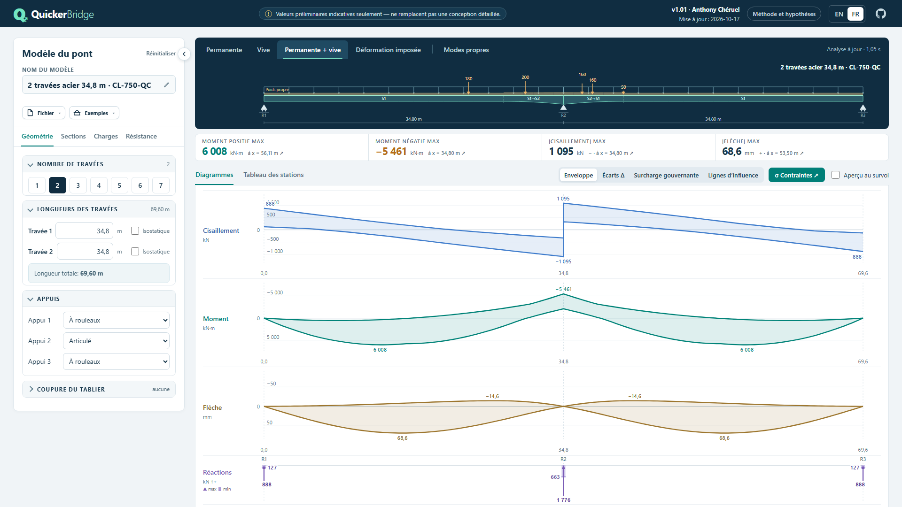

# QuickerBridge

**Preliminary analysis of continuous bridge girders, in your browser.**
Moving-load envelopes, influence lines, vibration modes and the CSA S6-25 truck load
fraction FT for girders of up to 7 spans — powered by
[PyCBA](https://ccaprani.github.io/pycba/) running locally through WebAssembly.
No installation, no server, no data leaves your computer.

**▶ Open the app: https://acheruel.github.io/QuickerBridge/**

*Version 1.01 · 2026-10-17 · Anthony Chéruel · [Version history](CHANGELOG.md)*

## What it does

- **Live loads:** CL-625, CL-750-QC (MTQ), AASHTO HL-93, Cooper E, maintenance or custom
  vehicles, S6 dynamic allowance, lane loads, pedestrian load; the governing arrangement
  of any extreme on a click.
- **Structure:** pinned, roller, integral (fixed) or spring supports, simple spans, split
  piers, deck cut; steel plate girders, NEBT precast girders or direct EI, composite
  inertia, non-prismatic haunches.
- **Outputs:** V, M, deflection, reactions and EI diagrams, influence lines, vibration
  modes, imposed deformations, staged stresses, steel resistance, S6-25 FT (slab on
  girders, slabs, steel grid, aluminum and wood decks), Excel workbook (FR/EN),
  `.quickerbridge.json` projects and side-by-side comparison.

## Use it

- **Web:** open the link above in a recent Chrome, Edge or Firefox.
- **Offline:** download `QuickerBridge-v<version>-<date>.html` from the repository root or
  the releases and double-click it (Internet is needed once for the Python runtime).

> **Indicative preliminary values only — not a substitute for detailed design.**
> Linear-elastic 1D beam, one traffic lane, longitudinal effects only. The author cannot
> be held liable for the results.

Validation: [VALIDATION.md](VALIDATION.md) · [NONPRISMATIC.md](NONPRISMATIC.md) ·
Development: [README_DEVELOPER.md](README_DEVELOPER.md)

## Credits and licence

Built on [PyCBA](https://github.com/ccaprani/pycba) by Colin Caprani (AGPL-3.0-or-later),
vendored with local additions; runs on [Pyodide](https://pyodide.org). See
[THIRD_PARTY_NOTICES.md](THIRD_PARTY_NOTICES.md).
